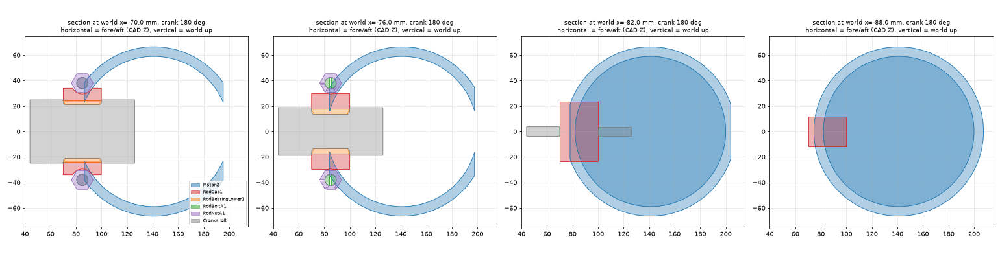

# R10 cycle overlaps: what causes them (20 October 2026)

An investigation of the 159 overlapping part pairs that the sampled pose audit finds in the computed 720-degree cycle of the GTSIO-520-H R10 card (`cad-studies/gtsio520-h-static/shipped-r10/interference-audit.json`, PR #82, rebuilt on the optimised file in PR #83). The investigation itself changed no model, contract, asset hash, Drive id or manifest. **Status: fixed on 20 October 2026 in a new release (see "Outcome of the fix" below); the sections before it describe the file of 19 October (decoded sha256 `1dcf07cc…`) and are kept as the record of the cause.** Everything below was measured on the shipped geometry of that date; where something is an estimate or was not checked, it says so.

## Result in one table

| Group | Pairs | Cause | Who can fix it |
|---|---|---|---|
| Core view: each piston against the big-end hardware (cap, bolts, nuts, lower bearing) of the rod on the other bank of its bay | 36 | **(a) real geometry**: the piston skirt and the neighbouring big end occupy the same space at bottom dead centre | FreeCAD geometry work (piston skirt relief), then a new asset hash and Drive release |
| Core view: crankshaft against each piston | 6 | **(a) real geometry**: the neighbour's crank pin reaches under the same skirt flank (same cause) | The same relief |
| Assembled view only: crank-mounted damper system, quill shaft, crank gear | 105 | **(c) held fixed**: parts that ride on the crankshaft are `fixed` in the contract | Contract and motion code only |
| Assembled view only: cam-mounted key and gears | 4 | **(c) held fixed** | Contract and motion code only |
| Assembled view only: counterweights against pistons | 8 | **(c)** now, and **(a) real geometry** after (c) is fixed (12 pairs, 287 mm³) | Geometry work, or a documented acceptance |

No group is **(b)** (phasing or kinematics) and none is **(d)** (audit artefact). The 42 and 117 split in the record is confirmed by a full re-run (below).

## What was checked

Kinematics (rules out (b)):

- `node scripts/check_gtsio_review.mjs` on the contract and unoptimised GLB as shipped on 19 October (sha256 `80991fa8…`): all six checks pass. The sampler reproduces the shared Python reference (`build/gtsio520-animation-review/reference-poses.json`, the file `cad_pipeline/gtsio_review_motion.py` writes) at 0, 137, 360 and 720 crank degrees, and agrees with independent slider-crank formulas between keys.
- Manual values, `GTSIO520_full_editable` (the DigiMan copy of the GTSIO-520 manual): firing order 1-4-5-2-3-6, bore 5.25 in, stroke 4 in, connecting rod bushing centre to crankpin centre 6.623 to 6.627 in. The code uses 1-4-5-2-3-6, a 2 in throw and 6.625 in. (The IO-520 manual says 1-6-3-2-5-4; it is a different engine and is not the reference here.) Piston diameter in the model, 133 mm, matches the manual's 5.2394 to 5.2404 in at the bottom of the skirt.
- Contract parameters: `case_cam_y` is -126 mm, which is where the camshaft sits in the GLB (the sampler's built-in defaults are for another model and are not used).
- Do the rods stay on the crank? `min_gap` between each big-end bearing shell and the crankshaft, and between each small-end bush and its piston pin, is 0.0 mm (touching, never open, never overlapping) at 13 sampled poses for all six rods. A phase or roll error would open a gap or overlap.

Audit method (rules out (d)):

- Every finding is 1 to 3 mm thick against a 0.05 mm noise threshold. Sections through the shipped meshes at the worst pose show the overlap by eye (figure below).
- The audit was reproduced on its own terms by a restricted tool (see "Faster audit") on four poses: 91 overlapping pairs, all in the ledger; the largest, Piston2 / RodCap1, 2,811.7 mm³ against the ledger's 2,814.2 mm³ (the ledger's maximum falls on a different 5-degree pose).

## Group 1: pistons against the neighbour's big end (a)

**Pairs.** Piston 1 with the hardware of rod 2, piston 2 with rod 1, 3 with 4, 4 with 3, 5 with 6, 6 with 5 (`RodCap`, `RodBoltA`, `RodBoltB`, `RodNutA`, `RodNutB`, `RodBearingLower`): 36 pairs; the crankshaft with `Piston1` to `Piston6`: 6 pairs. Peak size: `RodCap` 2,814 mm³ and 3.0 mm thick; nuts about 390 mm³; bolts 277 mm³; lower bearings 131.6 mm³; crankshaft 56 mm³ (0.8 mm).

**When.** The overlap lasts about 70 crank degrees around each bottom dead centre. Piston2 / RodCap1: 145 to 215 and 505 to 575; Piston4 / RodCap3: 265 to 335 and 625 to 695; Piston6 / RodCap5: 25 to 95 and 385 to 455 (the other three pistons the same, a few degrees apart). Together the six windows cover about 420 of 720 degrees: **at about 58 percent of crank angles at least one bay is overlapping in the default core view.** Source: a sweep of the 42 core-view ledger pairs at every 5 crank degrees.

**Why (mechanism).**

- The crank pins of an opposed pair are 180 degrees apart (the contract's pin phases at crank 0 are 0 and 180, 240 and 60, 120 and 300), so both pistons of a bay reach bottom dead centre together. That is how a flat engine moves; the pins are not a choice that could be re-phased to dodge the clash.
- At that moment the neighbour rod's big end sits at x = -50.8 mm (for bay 1) with the cap reaching x = -89.8 mm, while the skirt bottom of the other piston is at x = -69.5 mm. The cap is under the skirt.
- The bay pitch is 56 mm (crank pin width 30 plus cheek 26; `StaticEngineLayout` in `cad_pipeline/gtsio_layout.py` calls the axial estimates "recalibrated"; the manual has no figure for it). A full-diameter piston flank plus the cap half-width would need 66.5 + 14.9 = 81.4 mm to clear.
- The piston is a ring with a 7.5 mm wall (radii 59.0 and 66.5 mm) from about 12 mm above the skirt bottom; only the lowest 12 mm is relieved at the pin-axis ends (thrust panels only). The cap (fore-aft 70.1 to 99.9 mm) spans the part of that wall that lies at fore-aft 74.5 to 82 mm.
- Peak overlap, Piston2 / RodCap1 at 180 degrees: x -89.8 to -69.5, fore-aft 74.5 to 93.0, vertical +-34 mm. Crankshaft against Piston1 at 180 degrees: x 78.4 to 79.3, fore-aft 143.5 to 144.4, which is the neighbour's crank pin (reach 50.8 + 28.6 = 79.4 mm) at the skirt flank.

*Sections at world x = -70, -76, -82 and -88 mm at crank 180: piston 2 (blue), rod cap 1 (red), bearing, bolt and nut, crankshaft (grey). Horizontal is fore-aft, vertical is up. The red cap crosses the blue ring wall at -82 and -88.*

**Extra pitch alone does not fix it.** Moving Piston2 away along the engine axis, worst overlap against the union of the rod 1 hardware over 140 to 220 degrees: 3,918 mm³ at +0 mm, 3,005 at +8, 1,082 at +20, 140 at +24, **0 at +28 mm**. A pitch of about 84 mm instead of 56 would shift the even bank, heads, valve train and case by 28 mm: not a realistic change.

### How big a relief is needed (recommendation, not a decision)

Swept union of everything that overlaps a piston, expressed in that piston's own frame (2-degree steps from 140 to 220 crank degrees, 39 poses; measured on the unoptimised file, whose positions differ from the shipped file by at most 0.24 µm):

| Piston | Against | Volume to remove | Along the cylinder from the skirt bottom | Fore-aft (from the flank facing the neighbour) | Across |
|---|---|---|---|---|---|
| Piston2 (aft flank) | rod 1 hardware | 6,383 mm³ | 20.3 mm | 25.4 mm (z 74.5 to 99.9) | +-50.1 mm |
| Piston2 | crankshaft | 136 mm³ | 9.9 mm | 10.7 mm | +-33 mm |
| Piston1 (fore flank) | rod 2 hardware | 6,383 mm³ | 20.3 mm | 25.4 mm (z 126.1 to 151.5) | +-50.1 mm |
| Piston1 | crankshaft | 137 mm³ | 9.8 mm | 10.5 mm | +-33 mm |

The crank pieces lie inside the rod-hardware pieces except for the 136 mm³ at most, so one relief per piston covers both. The other four pistons are the same by symmetry (the ledger values for the three bays agree to 0.1 percent); odd and even pistons need mirror-image reliefs because the neighbour is on opposite sides.

Constraints the relief has to respect, from the piston's own geometry: the lowest ring groove (the scraper ring) starts 25.3 mm above the skirt bottom, so a relief 20.3 mm deep plus clearance leaves 3 to 5 mm of web; the pin boss is 48 mm up.

Options and what each costs:

1. **Skirt relief on the flank facing the neighbour (recommended).** A notch of at least 20.3 x 25.4 x 100 mm along, deep and across, removing at least 6.4 cm³ (1.8 percent of a 354 cm³ piston); add 1 to 2 mm clearance each way, about 22 x 27 x 103 mm. This is a slipper-style skirt: thrust panels only at the bottom. Cost: edit the piston part spec and FreeCAD recipe for six pistons (three mirror pairs), re-export, new asset hash, Drive upload and binding, re-run the sampled audit, take 42 entries off the ledger, update the contract's pending list and the gear and clip waivers (which are pinned to the asset hash). Whether a real GTSIO-520 piston has this relief is not in any source the project holds; the manual's dimension table has no piston length, pin-to-skirt distance, crank pin width or bay pitch. The relief is therefore an illustrative modelling decision and should be labelled so.
2. **Move the bays apart by about 28 mm.** Rejected: it moves the even bank, heads, valve train and case, and the crank length, and no source supports 84 mm.
3. **Shorten the skirt to about 28 mm below the pin** (it is 48 mm). Rejected: the scraper and oil rings sit 25 to 32 mm above the bottom and the skirt would stop guiding the piston.
4. **Accept and document.** The three bays are drawn overlapping for 58 percent of the cycle in the core view, which is the view the learner sees first; this is not a good teaching picture, and the card is labelled a draft.
5. **Hide the other bank's rods** during the core cycle. Rejected as a fix: the clash would stay in the Assembled view.

## Group 2: parts held fixed in the Assembled view (c)

**Composition of the 117.** Crankshaft against fixed parts, 105: the `dampers` group is 102 parts (`Counterweight1A` to `3B` x6, `DamperPin` x12, `BladeBush` x12, `WeightBush` x24, `DamperPlate` x24, `DamperRing` x24; the counterweights first overlap the crank at 10 degrees, 13,929 mm³ each), `QuillShaft` (845 mm³), `CrankshaftGear` against `IdlerGear` (498) and `StarterShaftGear` (417). Camshaft against fixed parts, 4: `CamClusterGear` against `FuelPumpDriveGear` (347) and `OilPumpDriver` (277), `CamshaftGear` against `OilPumpDriver` (159), `Camshaft` against `GovernorCamKey` (120). Fixed counterweights against pistons, 8 (219 to 771 mm³).

They show only in the Assembled view because `cycle_visible` in `cad_pipeline/gtsio_review_motion.py` hides unsolved connected mechanisms in the core view ("counterweights whose articulation/dynamics have not been solved"), while the Assembled view draws all 1,396 parts. The contract's `exclusions` list says damper oscillation and accessory motion are excluded.

**Test.** An experiment (not a change) on the shipped file, using a copy of the sampler with a `spin:<cx>,<cy>,<rate>` body kind that exists only in the investigator's `build/` folder: 72 poses (every 10 degrees), with

- the `dampers` group and `QuillShaft` following `crank`,
- `GovernorCamKey`, `OilPumpDriver` and `ScavengePumpDriver` following `cam`,
- the meshed gears turning at the rates the project already declares (`scripts/accessory_gears.py`, `solve_gtsio_accessory_drive()`; centres match the GLB): `IdlerGear` and `AccessoryIdlerGear` -0.714286, `LeftMagnetoGear` and `RightMagnetoGear` +1.5, `StarterShaftGear` -1.25, `FuelPumpDriveGear` +0.5, `OilPumpDriven` and `ScavengePumpDriven` +0.5, about their own centres.

Result: all 105 crank pairs and the cam and gear pairs of the ledger disappear. 34 overlapping pairs remain among the moved parts and their neighbours:

- **12 counterweight against piston pairs** (each of `Counterweight1A` to `3B` meets both pistons of its bay; 287 mm³, 1.59 mm thick; for example `Counterweight1B` / `Piston1` at 140 to 220 and 500 to 580 crank degrees). The counterweights reach up to about 92 mm from the crank axis, the skirt bottom comes down to 69.5 mm: real geometry, the same family as group 1. Those need geometry work (reduce the counterweights or relieve the pistons) or a documented acceptance.
- **22 pairs between a part that now moves and an attachment that still does not**: `QuillShaft` / `ReductionPinion` (944 mm³: the pinion and the propeller shaft, which the contract leaves fixed, turn with the crank at 1.0 and -0.667), `AccessoryIdlerGear` against `LeftAccessoryGear`, `RightAccessoryGear` (542 mm³) and the idler cluster screws, `IdlerClusterScrew1` to `4` against `IdlerGear`, the fuel and magneto couplings against their gears (189 to 203), `QuillPlateScrew1` and `2` against `QuillShaft`, `TachDriverPin`, `ScavengeDriveKey` and `GovernorDriveBevel` against the pump drivers and key, and two grazing magneto-gear pairs (about 1.5 mm³). Each is another **(c)**: the screws, couplings, keys and gears fixed to a turning part have to turn with it.

So the fix is a data and code change. It cannot be done by editing a single value because every moving gear and shaft drags its attachments.

**What the fix needs (proposal; the contract and `src/data/models.json` were not edited).**

- Contract: assign the `dampers` group, `QuillShaft` and its plate screws to `crank`; `GovernorCamKey`, `OilPumpDriver`, `ScavengePumpDriver`, `ScavengeDriveKey` and `TachDriverPin` to `cam`; and a new body kind for the meshed gears and everything that is fixed to them.
- Motion code (`src/viewer/core/animated-study-motion.mjs` and its Python twin `cad_pipeline/gtsio_review_motion.py`, which `scripts/check_gtsio_review.mjs` compares): a spinning-gear body kind, for example `gear:<id>` with the centre and signed rate from the declared train (`scripts/accessory_gears.py`, never typed into the viewer by hand, per `AGENTS.md`), and the crank and cam bodies' own list extended; rerun `check_gtsio_review.mjs` and the cycle audit. The propeller shaft and reduction pinion need the same treatment if they are to turn.
- If the gears are not wanted to turn in the Assembled view: hide the parts that cannot move correctly during the cycle, as the core view already does. This needs no motion work but shows a different engine in the two views.

## Re-run of the full audit (20 October 2026)

The full audit was run once more on the shipped optimised file (packed sha256 `64f433ab…2f52`, plain unpacked form `a2ab2fb9…`, decoded sha256 `1dcf07cc…`), with the commands in `docs/assembly-interference.md` but without the exploded poses: the assembled pose and 144 cycle poses at every 5 crank degrees, same policy and contract, written outside the repository so the committed record stays as it was.

- Assembled pose: 5,168 neighbouring pairs, all touching only; Three.js and the auditor read it identically (difference 0.0).
- Cycle: **159 overlapping pairs, 42 between parts the core view shows and 117 only in the Assembled view**. The set of pairs is identical to the committed record and the largest volumes are identical to four decimals (maximum difference 0.0000 mm³). No new violation, no stale ledger entry, no part that could not be intersected.
- Time: 1,938 s (32 minutes) for the assembled pose and the 144 cycle poses, alone on the machine (the 43 minutes in the record included the 10 exploded poses).

So the split is stable on the shipped file, and the causes above describe all 159 pairs.

## Outcome of the fix (20 October 2026)

The user decided to fix both groups in one change. **159 overlapping pairs became 2** (core view 42 to 0, Assembled view only 117 to 2) on the new file (decoded sha256 `7416aa5a90c0…`, 11,993,989 bytes transfer, 21,112,200 decoded; `docs/model-optimization.md`).
The audit is the full one of `docs/assembly-interference.md`: the assembled pose (5,160 neighbouring pairs, all touching only) and 144 cycle poses every 5 crank degrees, with the exploded layouts (informational, as before: transit poses hold up to 136 overlapping pairs, and the held layouts at the ends of stages 1 to 5 hold 5, 5, 14, 14 and 14).
Nothing new appeared: every pair found is one of the 2 that turning the gears uncovered. A second, restricted exact audit every **1 degree** (720 poses; pistons, rods, rings, crankshaft and the damper system against every other part, 476,948 pair tests) found **no overlap at all**,
so the relief's margin holds between the 5-degree poses too.

| | Before | After |
|---|---|---|
| Core view (the default) | 42 pairs | **0** |
| Assembled view only | 117 pairs | 2 (`AccessoryIdlerGear` against each magneto gear, 1.5 mm³ each, 0.35 mm thick) |
| Rest pose | clean | clean |

**Group 1: the piston skirt relief (an illustrative modelling decision, no source for the real piston).** One parameterised cut in `cad_pipeline/gtsio_core.py` (`piston_relief_*`, labelled as an illustrative modelling decision in the parameter rationale, the feature labels, the contract's `pending` list and here),
made of two boxes on the flank that faces the neighbouring bay, mirror-image for odd and even pistons: **22 x 27 x 103 mm** (height from the skirt bottom, depth in from the flank, width across the thrust faces) for the big-end hardware, and a shallower **9.4 x 51 x 116 mm** step for the crank counterweights.
This is the 20.3 x 25.4 x 100 mm minimum above with about 1.5 mm clearance each way, **plus the counterweights' swept volume** (7.9 mm high, 49.4 mm deep, 112.9 mm wide; they reach under the skirt as soon as they turn with the crank), so one relief clears everything.
It removes **16.1 cm³ per piston (4.5 percent of 354.9 cm³)** against 6.4 cm³ for the hardware alone, and leaves **3.0 to 3.25 mm of web** to the lowest ring groove (the scraper ring) and to the pin boss, so neither is touched; the relief stayed clear of the point where it would eat the ring groove or the boss, so no alternative had to be decided.
What the learner sees: the bottom corners of the thrust panels on the neighbour side are cut away (the counterweight step is the larger part of that). The alternatives, reshaping the counterweights or accepting the clash with a documented note, were not needed.
FreeCAD regenerates the six pistons (the recipe without the relief reproduces the shipped Piston2 to within two triangles of 6,774) and `scripts/graft_gtsio_r10_pistons.mjs` puts them into the unoptimised source.

**Group 2: parts the contract held fixed.** `cad_pipeline/gtsio_review_motion.py` and the viewer's evaluator (`src/viewer/core/animated-study-motion.mjs`, which must agree: `scripts/check_gtsio_review.mjs` passes, six checks) now assign **152 parts** to a moving body:
`crank` for the damper system (102 parts), `QuillShaft`, `ReductionPinion`, `QuillPlate` and its screws, and the alternator face gear with its screws and tab locks; `cam` for `GovernorCamKey`, `GovernorDriveBevel`, `OilPumpDriver`, `ScavengePumpDriver`, `ScavengeDriveKey`, `TachDriverBevel` and `TachDriverPin`;
and a new body kind `spin:px,py,pz,ax,ay,az,rate` for the gears, which turn about their own axes at the rates `scripts/accessory_gears.py` already declares (centres, axes and signs come from the same declaration; none is invented here). The Core view is unchanged: these parts stay hidden there.
The explosion is untouched (it reads the contract's `explosion` offsets, not the bodies; the collapse is still its exact inverse).

The remaining pairs of the earlier experiment, one by one (volumes at the worst pose, on the old file):

| Pairs | Cause | Parent body |
|---|---|---|
| `QuillShaft` / `ReductionPinion` (944 mm³) | the pinion sits on the quill shaft | both `crank`; `PropellerShaft` meshes with the pinion and turns at -0.667 about its own axis (the audit then finds the teeth clear at all 144 poses) |
| `QuillPlateScrew1`, `2` / `QuillShaft` (143 each), `QuillPlate` / screws (24 each) | the screws thread into the shaft and clamp the plate | `crank` (screws, then the plate) |
| `AccessoryIdlerGear` / `LeftAccessoryGear`, `RightAccessoryGear` (542 each) | the accessory gears are the idler's declared mates | spin at 1.142857 about their own centres, the idler at -0.714286 |
| `AccessoryIdlerGear`, `IdlerGear` / `IdlerClusterScrew1` to `4` (234 and 225 each) | the four screws clamp the two idler gears together | spin with the idler cluster |
| `FuelDriveCoupling` / `FuelPumpDriveGear` (203), `Left`/`RightMagnetoCoupling` / gears (189 each) | couplings sit in their gears | spin with their gear (0.5; 1.5) |
| `OilPumpDriver` / `TachDriverPin` (59), `OilPumpDriver` / `ScavengeDriveKey` (30), `ScavengeDriveKey` / `ScavengePumpDriver` (25) | pin and key join a gear to the cam-speed shaft | `cam`; the tach driven bevel, its pin and the output shaft spin at -0.5 about the X axis through the bevel apex (declared) |
| `GovernorCamKey` / `GovernorDriveBevel` (19) | the bevel is keyed to the cam | `cam`; the governor driven gear spins at -0.809 about the X axis through the bevel apex (declared) |
| 12 `Counterweight` / `Piston` pairs (287 mm³ each) | the counterweights, once they turn with the crank, sweep under the skirts | cleared by the counterweight step of the relief |
| found on the way: `AlternatorFaceScrew1` to `4` / `ReductionPinion` (197 each), `AlternatorFaceTabLock1`, `2` / screws (25 each), `AlternatorKeyedHub` / `AlternatorWoodruffKey` (4), `AlternatorRotorShaft` / key (16), `AlternatorCotter` / shaft (5) | the alternator face gear is bolted to the pinion and drives a pinion on the X axis | face gear, screws and tab locks `crank`; the pinion, hub, key, rotor shaft, washer, nut, cotter, bushing and coupling spring spin at 3.0 about the X axis through (40.5, 0, 619) |
| `AccessoryIdlerGear` / `LeftMagnetoGear`, `RightMagnetoGear` (1.5 mm³ each) | **real geometry, not a motion error.** The idler's teeth (z -48 to -36 mm, tip radius 56.75) and the magneto gear teeth (z -37 to -25, tip radius 30.8) overlap axially by 1 mm and the axes are 86.8 mm apart, so the tips pass through each other by up to 0.75 mm at some angles | **kept in the ledger** (`shipped-r10/interference-policy.json`, status `open`) with the fix: move one gear 1 mm along its axis or trim the teeth, an accessory-drive recipe change not made here |

The signs of the bevel and pinion meshes were checked rather than assumed: with the declared signs reversed the audit finds tooth overlaps (alternator pinion against face gear 77 mm³, governor 34, tach 10), with the declared signs none.

**One consequence to know about.** A gear that turns at a fixed ratio to the crank returns to its start pose after the 720-degree cycle only when twice its ratio is a whole number. Eleven parts do not (the idler and its four screws, the accessory idler, the starter gear, the propeller shaft, the two accessory gears and the governor driven gear),
so when the looped cycle restarts they jump to their start angle: gear teeth look identical, screws and couplings on them jump. This is visible only in the Assembled view. `scripts/check_gtsio_review.mjs` counts these parts instead of failing on them.
Making the loop seamless would need rates that break the declared meshes, so it was not done.

**Guard checks.** `scripts/test_gtsio_spin_body.mjs` and `scripts/test_gtsio_review_motion.py` (in CI) test the new body kind and that the declared rates, centres and axes are the ones used. The committed audit record is read by `scripts/test_interference_audit.mjs`, which fails on any overlap outside the ledger and now also on a core-view overlap or a ledger longer than the two known pairs.
A motion-coverage check in the closure-check framework (parts that touch or fit statically must share a moving body unless the pair is a declared joint or sliding fit) needs the rest-pose touching pairs and a list of declared joints; the audit does not write the touching pairs down, so it was not built here.

## Faster audit (audit-side change)

The full run (1,396 parts read, 144 cycle poses) takes about 45 minutes on the 8 GB machine. A restricted audit gives the same answers for any change that moves only some parts: take the world bounding box of every part from the sampler for each pose, build exact solids only for pairs that involve a part from a chosen "focus" set (the parts whose body changed), and skip pairs that share a pose change (as the audit already does). The prototype (`variant_audit.py`, kept outside the repository with its sampler variant) ran the 114-part focus above over 72 poses in 120 seconds and 26,744 pair tests. On four baseline poses it reproduced the ledger exactly (91 pairs, all in the ledger). It is not a replacement for the full audit at release; it is a cheap way to check a contract change before the full run. Two small improvements to the audit's own record would also have saved most of this investigation: write each overlap's intersection bounding box, and the crank angle range of every overlap, into `interference-audit.json`.

## Not done, and limits

- The relief sizes come from sampling every 2 degrees; an overlap narrower than that could be missed, so the clearance margin above matters. They were measured on the unoptimised file (the shipped file differs by at most 0.24 µm).
- The spin-body experiment shows that the declared rates remove the listed overlaps, not that the gears mesh correctly at every angle; tooth-level meshing is only checked as far as the overlap threshold.
- The relief and pitch options above were computed, not modelled; the relief of the outcome section was then cut in FreeCAD and audited.
- The real engine's piston skirt, crank pin width and bay pitch are not in the project's sources.

## Files

The investigator's tools and intermediate outputs are not in the repository. The ones that matter are in the shared notes folder for this group of sessions. The commands that reproduce the full audit are in `docs/assembly-interference.md`; `scripts/check_gtsio_review.mjs` needs `build/gtsio520-animation-review/` (ignored files).
